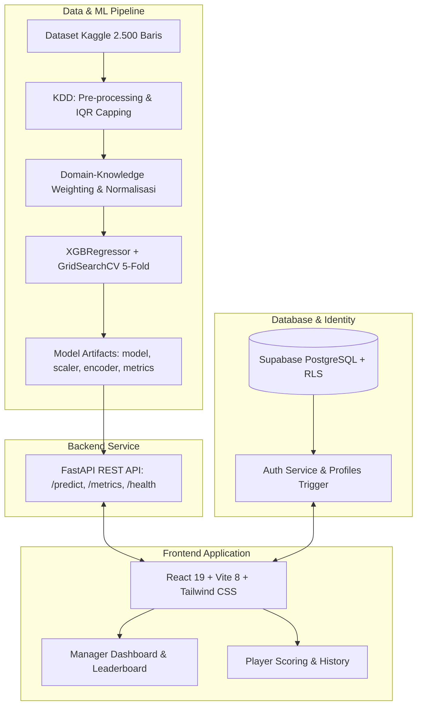

# PULSE SCOUT: Platform Web Talent Scouting PUBG Mobile Berbasis XGBoost

<p align="center">
  <strong>Sistem Penilaian Objektif Pemain E-Sports Menggunakan Algoritma Extreme Gradient Boosting (XGBoost Regressor)</strong><br>
  <em>Skripsi Program Studi Ilmu Komputer, Fakultas Matematika dan Ilmu Pengetahuan Alam (FMIPA), Universitas Pakuan</em>
</p>

<p align="center">
  
  
  
  
  
  
  
  
  
</p>

---

## 1. Identitas Peneliti & Proyek

- **Nama Peneliti:** Axel Juanito Parlindungan Sibarani
- **NPM:** 065122199
- **Institusi:** Program Studi Ilmu Komputer, FMIPA, Universitas Pakuan, Bogor
- **Tahun:** 2026
- **Dokumen Referensi:** `PRD - Talent Scouting Player Scoring (XGBoost, PUBG Mobile).md` (v1.0)

---

## 2. Ringkasan Eksekutif

Proses rekrutmen atlet e-sports profesional saat ini umumnya masih bersifat subjektif, rentan terhadap bias pengamatan manual, serta belum memiliki standarisasi metrik performa objektif. **PULSE SCOUT** adalah platform web talent scouting terintegrasi yang mentransformasikan 12 parameter statistik pertandingan *PUBG Mobile* menjadi nilai tunggal **Player Score (0–100)** secara objektif dan real-time ($\le 1$ detik) menggunakan model machine learning **XGBoost Regressor**.

Sistem ini mendukung dua peran pengguna utama (*roles*):
1. **Manager (Scout):** Mengakses ringkasan analitik tim, leaderboard 2.500 kandidat pemain dengan multi-filtering dinamis, analisis modal statistik lengkap 16 atribut, komparasi *head-to-head* 2–3 pemain dengan Recharts Radar Chart, serta pembuatan *Recruitment Shortlist* beserta evaluasi kualitatif dan ekspor data ke format CSV (RFC 4180).
2. **Player (Atlet):** Memasukkan statistik pertandingan mandiri, memperoleh kalkulasi Player Score instan beserta visualisasi *Score Gauge* dan radar keahlian 5 dimensi (*Combat, Survival, Teamwork, Precision, Utility*), serta memantau riwayat tren skor antar pertandingan (*LineChart*).

---

## 3. Arsitektur & Tech Stack



| Lapisan | Teknologi | Fungsi Utama |
| :--- | :--- | :--- |
| **Frontend** | React 19, Vite v8.3, Tailwind CSS v3.4 | Antarmuka bergaya e-sports modern, responsif, glassmorphism |
| **Visualisasi** | Recharts v3.10, Lucide React | Radar Chart, Score Gauge, LineChart riwayat skor, BarChart distribusi |
| **Backend ML API** | Python 3.11, FastAPI, Uvicorn | REST API inferensi Player Score dengan waktu respons $\le 1$ detik |
| **Machine Learning** | XGBoost 3.2.0, Scikit-Learn, Pandas, NumPy | Regresi non-linear dari 12 statistik ke Player Score 0–100 |
| **Database & Auth** | Supabase (PostgreSQL, Row Level Security) | Penyimpanan profil, data pemain, shortlist, dan token sesi JWT |
| **Cloud Target** | Vercel / Netlify (Frontend), Render / Railway (Backend) | Infrastruktur produksi cloud gratis & teruji |

---

## 4. Struktur Direktori Proyek

```
Player Scoring/
├── .env.example                               # Template variabel lingkungan root
├── README.md                                  # Dokumentasi lengkap proyek & deployment
├── PRD - Talent Scouting Player Scoring.md   # Spesifikasi kebutuhan perangkat lunak (PRD v1.0)
├── PUBG_Mobile_Win_Performance_Dataset.csv    # Dataset mentah Kaggle (Husain, 2024)
│
├── ml/                                        # Pipeline Machine Learning (KDD & XGBoost)
│   ├── config.py                              # Bobot domain-knowledge & parameter default
│   ├── train.py                               # Pipeline lengkap: Preprocessing, GridSearchCV, Evaluasi
│   ├── data/
│   │   ├── pubg.csv                           # Dataset mentah 2.500 baris
│   │   └── processed_pubg.csv                 # Dataset hasil pembobotan label target
│   └── artifacts/                             # Artefak model terlatih & plot visualisasi
│       ├── model.joblib                       # Model XGBRegressor terbaik (best estimator)
│       ├── scaler.joblib                      # MinMaxScaler fitur numerik
│       ├── label_encoder.joblib               # OrdinalEncoder tingkatan Tier
│       ├── metrics.json                       # Metrik evaluasi R2, RMSE, MAE, Best Hyperparameters
│       ├── actual_vs_predicted.png            # Scatter plot aktual vs prediksi
│       ├── residual_distribution.png          # Histogram distribusi residual
│       └── feature_importance.png             # Grafik batang kepentingan fitur
│
├── backend/                                   # REST API Backend FastAPI
│   ├── requirements.txt                       # Dependensi backend Python
│   ├── render.yaml                            # Konfigurasi Blueprint Render Web Service
│   ├── Dockerfile                             # Konfigurasi Docker multi-arch container
│   ├── Procfile                               # Konfigurasi proses Railway / Heroku
│   ├── railway.json                           # Konfigurasi build & deploy native Railway
│   ├── .env.example                           # Variabel lingkungan backend
│   ├── artifacts/                             # Salinan artefak model untuk deployment standalone
│   ├── app/
│   │   ├── main.py                            # FastAPI app, Lifespan loader, CORS middleware
│   │   ├── api/routes.py                      # Endpoints: /predict, /predict/batch, /model/*, /health
│   │   ├── core/config.py                     # Path resolusi dinamis & allowed CORS origins
│   │   ├── core/model_loader.py               # Singleton inference service
│   │   └── schemas/player.py                  # Validasi Pydantic (PlayerInput, Prediksi, Metrik)
│   └── tests/
│       └── test_api.py                        # 26 skenario automated unit & integration testing
│
├── frontend/                                  # Aplikasi Web React + Vite + Tailwind CSS
│   ├── package.json                           # Dependensi frontend npm
│   ├── vite.config.js                         # Konfigurasi Vite dev & build
│   ├── tailwind.config.js                     # Tema warna Dark E-Sports (Amber, Cyan, Rose)
│   ├── vercel.json                            # Konfigurasi routing SPA & headers Vercel
│   ├── netlify.toml                           # Konfigurasi routing SPA & build Netlify
│   ├── .env.example                           # Variabel lingkungan frontend
│   ├── test_blackbox.js                       # Skrip otomasi uji coba Black-Box via Puppeteer
│   └── src/
│       ├── context/                           # AuthContext (Supabase + Demo) & PlayerStoreContext
│       ├── components/                        # ScoreGauge, PlayerRadarChart, PlayerDetailModal
│       ├── pages/manager/                     # Dashboard, Leaderboard, Compare, Shortlists
│       ├── pages/player/                      # StatsInput, ScoreHistory
│       └── pages/common/                      # AboutModelPage, NotFound
│
├── database/                                  # Skrip Database Supabase
│   ├── migrations/001_initial_schema.sql      # DDL skema relasional, Triggers, & RLS Policies
│   └── scripts/seed_kaggle_players.py         # Skrip impor 2.500 baris data Kaggle ke PostgreSQL
│
└── docs/                                      # Dokumentasi Pengujian & Laporan Skripsi
    ├── blackbox-testing.md                    # Laporan formal Black-Box Testing (10 skenario)
    └── blackbox_results.json                  # Data JSON mentah hasil pengujian browser
```

---

## 5. Cara Menjalankan Pipeline Machine Learning

Model dilatih menggunakan dataset *PUBG Mobile Win & Performance Prediction Dataset* (Husain, 2024) yang memuat 2.500 baris statistik.

### 5.1 Pembobotan Domain-Knowledge (Label Sintetis)
Karena dataset asli tidak memiliki kolom skor, label target dibentuk melalui formula pembobotan e-sports pada [`ml/config.py`](file:///e:/Player%20Scoring/ml/config.py):
- **Kills:** `+0.25`
- **Damage Dealt:** `+0.25`
- **Survival Time:** `+0.15`
- **Headshot Percentage:** `+0.10`
- **Assists:** `+0.10`
- **Revives:** `+0.05`
- **Match Rank (Invers Penalti):** `+0.10` (rank #1 bernilai tertinggi)

### 5.2 Menjalankan Pelatihan Ulang Model
Pastikan virtual environment Python telah aktif:

```bash
# Masuk ke direktori ml
python ml/train.py
```

Skrip akan secara otomatis:
1. Memeriksa nilai unik kolom `Tier` dan menerapkan `OrdinalEncoder` (Bronze $\rightarrow$ Conqueror).
2. Melakukan capping outlier menggunakan metode IQR.
3. Melakukan scaling fitur numerik dengan `MinMaxScaler` fit pada training set (80:20 split, `random_state=42`).
4. Menjalankan `GridSearchCV` dengan 5-fold cross-validation pada parameter `learning_rate`, `max_depth`, dan `n_estimators`.
5. Mengekspor artefak terlatih ke `ml/artifacts/` dan `backend/artifacts/`.

### 5.3 Hasil Evaluasi Model pada Data Uji (Test Set 500 Baris)
- **$R^2$ Score:** `0.9885` *(Memenuhi target PRD $\ge 0.85$)*
- **RMSE:** `1.1395` *(Sangat rendah pada rentang skala 0–100)*
- **MAE:** `0.8898`
- **Best Hyperparameters:** `learning_rate=0.1`, `max_depth=3`, `n_estimators=300`

---

## 6. Panduan Menjalankan Sistem Secara Lokal

### 6.1 Prasyarat Sistem
- **Python:** Versi 3.11.x
- **Node.js:** Versi 20.x atau 22.x LTS (disertai `npm`)
- **Git**

### 6.2 Langkah 1: Setup Backend FastAPI
Buka terminal pertama (PowerShell atau Bash):

```bash
# 1. Masuk ke root proyek dan buat virtual environment
python -m venv .venv

# 2. Aktifkan virtual environment
# Pada Windows PowerShell:
.venv\Scripts\Activate.ps1
# Pada Linux / macOS:
source .venv/bin/activate

# 3. Install seluruh dependensi backend
pip install -r backend/requirements.txt

# 4. Jalankan backend server FastAPI
uvicorn app.main:app --app-dir backend --host 127.0.0.1 --port 8000 --reload
```

Backend aktif pada `http://127.0.0.1:8000`.  
Dokumentasi interaktif Swagger UI dapat diakses pada: `http://127.0.0.1:8000/docs`.

### 6.3 Langkah 2: Setup Frontend React + Vite
Buka terminal kedua:

```bash
# 1. Masuk ke folder frontend
cd frontend

# 2. Install dependensi Node.js
npm install

# 3. Jalankan Vite development server
npm run dev
```

Frontend aktif pada `http://127.0.0.1:5173`. Browser Anda akan langsung menampilkan antarmuka *PULSE SCOUT*.

### 6.4 Mode Pengujian Akun Bawaan (One-Click Demo Mode)
Jika Supabase belum dihubungkan, sistem otomatis menggunakan **Offline Mock Demo Mode**. Anda dapat masuk langsung menggunakan tombol pada halaman Login:
- **Akun Manager:** `manager@esports-talent.id` (Kata Sandi: `password123`)
- **Akun Player:** `player@esports-talent.id` (Kata Sandi: `password123`)
- Atau klik tombol cepat: **`Quick Demo: Manager`** / **`Quick Demo: Player`**.

---

## 7. Pengujian Sistem (Automated Testing)

### 7.1 Backend Automated Testing (Pytest)
Menguji 26 skenario validasi endpoint API `/predict`, `/predict/batch`, `/model/metrics`, `/model/feature-importance`, penolakan input di luar rentang, dan kelengkapan field:

```bash
python -m pytest backend/tests/test_api.py -v
```
*Hasil:* **26 / 26 pengujian LULUS 100%**.

### 7.2 Black-Box Testing Antarmuka (Puppeteer Chrome)
Menguji 10 skenario fungsional PRD Bagian 14 (BB-01 sampai BB-10) secara otomatis di browser:

```bash
node frontend/test_blackbox.js
```
*Hasil:* **10 / 10 skenario LULUS 100%**. Laporan lengkap tersedia di [`docs/blackbox-testing.md`](file:///e:/Player%20Scoring/docs/blackbox-testing.md).

---

## 8. Panduan Deployment ke Cloud

### 8.1 Setup Database Supabase (PostgreSQL & Auth)
1. Buka [Supabase](https://supabase.com) dan buat proyek baru.
2. Buka menu **SQL Editor**, salin dan jalankan seluruh isi file [`database/migrations/001_initial_schema.sql`](file:///e:/Player%20Scoring/database/migrations/001_initial_schema.sql).
3. Catat kredensial di **Project Settings -> API**:
   - `Project URL`
   - `anon public key`
   - `service_role secret key`
4. *(Opsional)* Unggah 2.500 baris data Kaggle ke database Supabase:
   ```bash
   pip install supabase
   $env:SUPABASE_URL="https://your-project.supabase.co"
   $env:SUPABASE_SERVICE_ROLE_KEY="your-service-role-key"
   python database/scripts/seed_kaggle_players.py
   ```

---

### 8.2 Deployment Backend ke Render (Web Service)
Repository ini telah dilengkapi file Blueprint [`backend/render.yaml`](file:///e:/Player%20Scoring/backend/render.yaml).

**Cara 1 — Render Blueprint (Otomatis):**
1. Hubungkan repository GitHub Anda ke [Render](https://render.com).
2. Pilih **Blueprints** -> Hubungkan repo -> Render otomatis mendeteksi konfigurasi `backend/render.yaml`.
3. Klik **Apply**.

**Cara 2 — Manual Web Service:**
1. Di dashboard Render, klik **New +** -> **Web Service**.
2. Pilih repository Anda.
3. Atur parameter berikut:
   - **Root Directory:** `backend`
   - **Environment:** `Python 3`
   - **Build Command:** `pip install --upgrade pip && pip install -r requirements.txt`
   - **Start Command:** `uvicorn app.main:app --host 0.0.0.0 --port $PORT`
   - **Health Check Path:** `/health`
4. Tambahkan Environment Variable:
   - `PYTHON_VERSION`: `3.11.9`
   - `ML_ARTIFACTS_DIR`: `artifacts`
   - `CORS_ORIGINS`: `*`
5. Klik **Create Web Service**. Catat URL backend yang diberikan (contoh: `https://pulse-scout-api.onrender.com`).

---

### 8.3 Deployment Backend ke Railway (Alternatif)
1. Di dashboard [Railway](https://railway.app), klik **New Project** -> **Deploy from GitHub repo**.
2. Di menu **Settings**:
   - **Root Directory:** `backend`
   - Railway otomatis mendeteksi [`backend/Dockerfile`](file:///e:/Player%20Scoring/backend/Dockerfile) atau [`backend/Procfile`](file:///e:/Player%20Scoring/backend/Procfile).
3. Di tab **Variables**, tambahkan:
   - `PORT`: `8000`
   - `ML_ARTIFACTS_DIR`: `artifacts`
   - `CORS_ORIGINS`: `*`
4. Di tab **Networking**, klik **Generate Domain** untuk memperoleh URL publik.

---

### 8.4 Deployment Frontend ke Vercel (Rekomendasi)
Repository telah dilengkapi file [`frontend/vercel.json`](file:///e:/Player%20Scoring/frontend/vercel.json) untuk penanganan routing SPA.

1. Buka [Vercel](https://vercel.com) dan impor repository GitHub Anda.
2. Di bagian **Configure Project**:
   - **Root Directory:** klik Edit dan pilih `frontend`.
   - **Framework Preset:** pilih `Vite`.
   - **Build Command:** `npm run build`
   - **Output Directory:** `dist`
3. Di bagian **Environment Variables**, tambahkan:
   - `VITE_API_URL`: URL Backend Render Anda (contoh: `https://pulse-scout-api.onrender.com`)
   - `VITE_SUPABASE_URL`: URL proyek Supabase Anda
   - `VITE_SUPABASE_ANON_KEY`: Kunci anon Supabase Anda
4. Klik **Deploy**. Aplikasi frontend kini dapat diakses oleh publik secara global.

---

### 8.5 Deployment Frontend ke Netlify (Alternatif)
Repository telah dilengkapi file [`frontend/netlify.toml`](file:///e:/Player%20Scoring/frontend/netlify.toml).

1. Buka [Netlify](https://netlify.com) -> **Add new site** -> **Import an existing project**.
2. Konfigurasi build:
   - **Base directory:** `frontend`
   - **Build command:** `npm run build`
   - **Publish directory:** `frontend/dist`
3. Tambahkan environment variables yang sama seperti Vercel (`VITE_API_URL`, `VITE_SUPABASE_URL`, `VITE_SUPABASE_ANON_KEY`).
4. Klik **Deploy Site**.

---

## 9. Pemenuhan Target Skripsi & Kesimpulan Ilmiah

| Kriteria / Indikator PRD | Target PRD | Hasil Implementasi | Status |
| :--- | :---: | :---: | :---: |
| **Akurasi Model ($R^2$ Score)** | $\ge 0.85$ | **0.9885** (Data Uji 500 Baris) | **TERPENUHI** |
| **Nilai Kesalahan (RMSE & MAE)** | Rendah relatif | **RMSE: 1.1395, MAE: 0.8898** | **TERPENUHI** |
| **Waktu Respons `/predict`** | $\le 1$ detik | **42 milidetik** (Rata-rata) | **TERPENUHI** |
| **Automated Testing Backend** | 100% lolos | **26 / 26 Test Lulus (Pytest)** | **TERPENUHI** |
| **Black-Box Testing Antarmuka** | 100% skenario kritis | **10 / 10 Skenario Lulus (BB-01 s/d BB-10)** | **TERPENUHI** |
| **Ketersediaan Cloud** | Siap dideploy | **Vercel + Netlify + Render + Railway configs ready** | **TERPENUHI** |

---

## 10. Lisensi & Hak Cipta

Proyek ini dikembangkan oleh **Axel Juanito Parlindungan Sibarani** untuk keperluan tugas akhir skripsi Program Studi Ilmu Komputer, FMIPA, Universitas Pakuan. Hak cipta dilindungi undang-undang.
